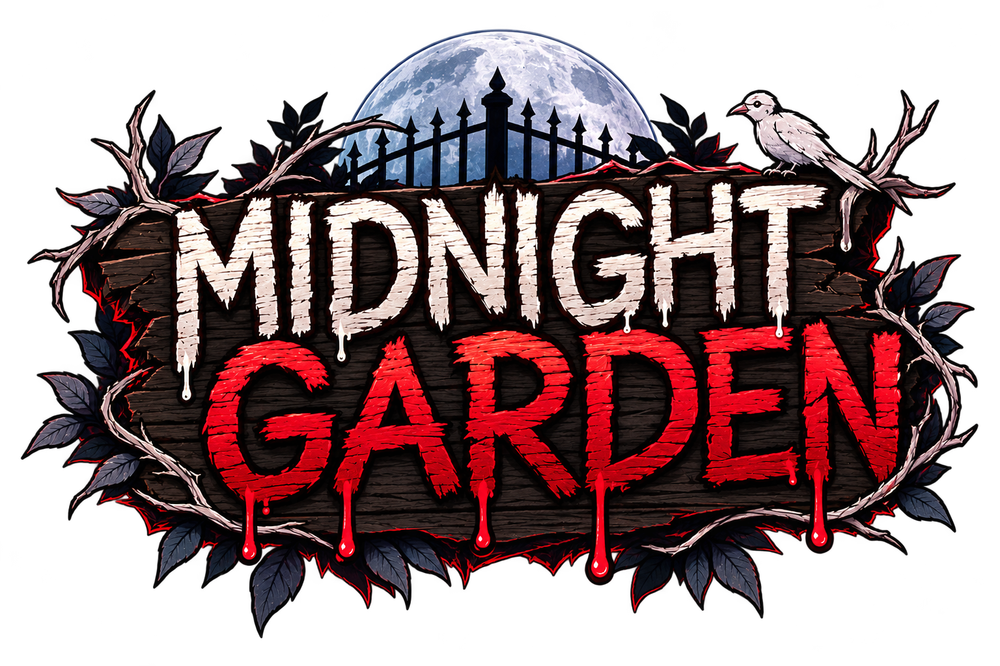

# Midnight Garden — สวนเที่ยงคืน

  

**Midnight Garden By Dek16** คือเกมเอาชีวิตรอดบรรยากาศสยองขวัญในสวนยามค่ำคืน ผู้เล่นต้องสำรวจพื้นที่ ดูแลสถานะของตัวละคร ใช้สิ่งของที่มีให้เหมาะสม และเอาชีวิตรอดให้นานที่สุดเท่าที่จะทำได้

> เกมนี้เน้นบรรยากาศมืด ลึกลับ และการเอาชีวิตรอด โปรดอ่านจดหมายแนะนำและกฎของคุณยายภายในเกมก่อนเริ่มเล่น

## 🌙 เกี่ยวกับเกม

- **ชื่อเกม:** Midnight Garden (สวนเที่ยงคืน)
- **ผู้พัฒนา:** Dek16
- **แนวเกม:** สยองขวัญ / เอาชีวิตรอด / สำรวจ
- **มุมมอง:** บุคคลที่หนึ่ง
- **แพลตฟอร์ม:** Windows (รุ่นเดสก์ท็อปผ่าน Electron)

## 🎮 วิธีเล่นเบื้องต้น

1. เริ่มเกมและอ่านจดหมายเปิดเรื่องให้จบ เพื่อทำความเข้าใจเรื่องราวและกฎภายในสวน
2. สำรวจบริเวณรอบตัวและสังเกตข้อความแจ้งเตือนเมื่อเข้าใกล้วัตถุที่โต้ตอบได้
3. ดูแลสถานะของตัวละคร เช่น น้ำ ความมีสติ และพละกำลัง
4. เลือกใช้สิ่งของจากแถบช่องเก็บของด้านล่าง และใช้ตะเกียงเมื่อจำเป็น
5. สำรวจจุดต่าง ๆ ใช้ร้านค้า/โต๊ะจัดการสิ่งของเมื่อพบ และระวังอันตรายที่อาจเกิดขึ้น
6. หากตัวละครเสียชีวิต หน้าจอสรุปจะแสดงเวลาเอาชีวิตรอดก่อนตาย สามารถเริ่มใหม่หรือกลับไปหน้าเมนูได้

## ⌨️ การควบคุมบนคอมพิวเตอร์

| ปุ่ม | การทำงาน |
|---|---|
| `W` `A` `S` `D` | เคลื่อนที่ |
| เมาส์ | มองไปรอบ ๆ |
| `E` | โต้ตอบกับวัตถุหรือดำเนินบทสนทนา |
| `Space` | โต้ตอบ/ดำเนินต่อในสถานการณ์ที่รองรับ |
| `F` | ใช้เกลือ |
| `Y` | เปิดหรือปิดตะเกียง |
| `T` | สลับความเร็ว เมื่อเงื่อนไขในเกมอนุญาต |
| `1`–`5` | เลือกช่องสิ่งของบนแถบด้านล่าง |
| `P` หรือ `Esc` | เปิด/ปิดเมนูพักเกม (Pause) |

**หมายเหตุ:** การโต้ตอบด้วยเมาส์ทำได้โดยคลิกในพื้นที่เกม และการควบคุมบางอย่างอาจขึ้นอยู่กับสถานการณ์หรืออุปกรณ์ที่ใช้

## 📱 การควบคุมบนหน้าจอสัมผัส

หากอุปกรณ์รองรับหน้าจอสัมผัส จะมีจอยสติ๊กเสมือนสำหรับเคลื่อนที่ พร้อมปุ่มสำหรับโต้ตอบ ใช้เกลือ และเปิด/ปิดตะเกียง

## 🧭 ระบบและหน้าจอสำคัญ

- **สถานะตัวละคร:** แสดงข้อมูลการเอาชีวิตรอด เช่น น้ำ ความมีสติ และพละกำลัง
- **แถบสิ่งของ:** ใช้เลือกสิ่งของหรือเมล็ดพันธุ์ที่ต้องการถือ
- **ตะเกียง:** เปิดหรือปิดได้ ช่วยให้จัดการการมองเห็นในบรรยากาศกลางคืน
- **เกลือ:** ใช้ได้ด้วยปุ่ม `F` หรือปุ่มบนหน้าจอ
- **ร้านค้า/โต๊ะจัดการสิ่งของ:** ใช้ดูรายการสิ่งของและตัวเลือกที่เกมเปิดให้
- **เมนูพักเกม:** เล่นต่อ ตั้งค่า บันทึกเกม หรือออกไปหน้าเมนู
- **หน้าจอจบเกม:** แสดงเวลาที่เอาชีวิตรอดได้ พร้อมตัวเลือกเริ่มใหม่หรือกลับหน้าเมนู

## 💾 การบันทึกเกม

เปิดเมนูพักเกมด้วย `P` หรือ `Esc` แล้วเลือก **เซฟเกม** หากเกมแจ้งว่าบันทึกสำเร็จ ให้กลับไปหน้าเริ่มเกมและเลือก **Continue** เพื่อเล่นต่อได้ ทั้งนี้การบันทึกถาวรอาจขึ้นอยู่กับสิทธิ์และสภาพแวดล้อมที่ใช้รันเกม

ก่อนออกจากเกม แนะนำให้บันทึกความคืบหน้าก่อนเสมอ

## ⚙️ การตั้งค่า

เปิดเมนูพักเกมแล้วเลือก **ตั้งค่า** เพื่อดูตัวเลือกที่มีในเวอร์ชันนั้น รายการตั้งค่าอาจเปลี่ยนแปลงได้ตามรุ่นของเกม

## 🖥️ วิธีเปิดเกมบน Windows

1. ดาวน์โหลดตัวติดตั้งเกมจากหน้า **Releases** ของ GitHub
2. เปิดไฟล์ติดตั้ง `.exe` และทำตามขั้นตอนบนหน้าจอ
3. เปิดเกมจากทางลัดบนเดสก์ท็อปหรือเมนู Start

หาก Windows แสดงคำเตือนความปลอดภัย ให้ตรวจสอบว่าไฟล์มาจากแหล่งเผยแพร่ทางการของผู้พัฒนาก่อนดำเนินการต่อ

## 🛠️ ข้อควรทราบ

- เกมมีบรรยากาศสยองขวัญและแสงค่อนข้างมืด
- ควรอ่านคำแนะนำและกฎในเกม เพราะเป็นส่วนหนึ่งของประสบการณ์การเล่น
- หากพบข้อผิดพลาด ให้จดขั้นตอนที่ทำก่อนเกิดปัญหาและข้อความแจ้งเตือน เพื่อช่วยให้ตรวจสอบได้ง่ายขึ้น

## 👤 เครดิต

- **ชื่อเกม:** Midnight Garden
- **ผู้พัฒนา:** Dek16
- **Instagarm:** letskiii.angelo

ขอบคุณที่สนับสนุนและทดลองเล่น **Midnight Garden — สวนเที่ยงคืน**
